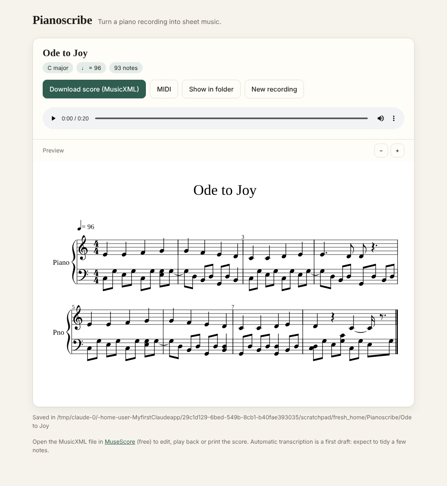

# pianoscribe

Turn a recording of solo piano into sheet music. Drag in a **WAV or MP3**, get a score.



## Using the app (no typing needed)

**One-time setup:** install Python 3.12 or 3.13 from [python.org](https://www.python.org/downloads/).
On Windows, tick **"Add python.exe to PATH"** in the installer.

**Then, every time:**

1. Double-click the launcher in this folder:
   - Windows: **`Start Pianoscribe (Windows).bat`**
   - Mac: **`Start Pianoscribe (Mac).command`** (the very first time, right-click it → **Open** → **Open**,
     because macOS is cautious about downloaded files)
2. A small window appears and your web browser opens Pianoscribe. The first start takes a few minutes
   while it sets itself up; after that it opens in seconds.
3. Drag your WAV or MP3 onto the page (or click **Choose a file…**).
4. When it's done you see the sheet music, can listen to your recording next to it, and can
   **Download score (MusicXML)** to open in [MuseScore](https://musescore.org) (free) for editing,
   playback and printing. Everything is also saved in **Documents › Pianoscribe**.

To quit, close the small window. Everything runs on your own computer; recordings are never uploaded.

If the rhythm looks off, open **Options**, set the time signature and tempo, and drop the file again.

## Using the command line (optional)

```bash
pip install -e .            # DSP engine, no GPU or model download
pip install -e ".[neural]"  # + the neural engine (recommended for real recordings)
pianoscribe my_recording.mp3
pianoscribe-app             # opens the drag-and-drop app
```

Input: **WAV** and **MP3** (also FLAC, OGG, Opus, AIFF, and the audio track of MP4/MOV/M4A files).
ffmpeg is bundled through the `imageio-ffmpeg` dependency. MIDI (`.mid`) input skips transcription.
Output, in `transcriptions/`:

| file | what it is |
| --- | --- |
| `my_recording.musicxml` | the score — open in MuseScore, Finale, Sibelius, Dorico, Noteflight… |
| `my_recording.html` | the score rendered in your browser, no software needed |
| `my_recording.score.mid` | the quantized score as MIDI |
| `my_recording.pdf` | engraved PDF (with `--pdf`, needs [MuseScore](https://musescore.org) installed) |
| `my_recording.performance.mid` | raw, unquantized transcription (with `--performance-midi`) |

## How it works

```
audio ──► note detection ──► beat tracking & quantization ──► hand split, key, notation ──► MusicXML / MIDI / HTML / PDF
```

1. **Note detection** (`pianoscribe/transcribe.py`), two engines:
   - **`neural`** — the ByteDance *High-resolution Piano Transcription* model
     (Kong et al. 2021, ~96% note F1 on the MAESTRO benchmark). Used automatically when
     `torch` and `piano_transcription_inference` are installed; downloads a ~165 MB
     checkpoint on first use. **Use this for real recordings.**
   - **`dsp`** — a dependency-light signal-processing engine: constant-Q spectrogram →
     iterative harmonic-salience estimation with spectral subtraction (Klapuri 2006) →
     onset-driven note tracking (a note can only begin at a detected hammer strike, and
     only on keys whose energy jumps there) → removal of semitone/octave "ghost" notes.
2. **Rhythm** (`quantize.py`) — beats are tracked in the audio and note times are mapped
   onto them by interpolation, so tempo drift and rubato don't wreck the notation. Positions
   are rounded to a grid (16ths by default). Half/double-tempo beat tracking is corrected.
3. **Notation** (`score.py`) — notes are split between the hands (by register, splitting
   wide chords at their largest gap), the key is estimated (Krumhansl–Schmuckler) for the
   key signature and sharp/flat spelling, and a grand-staff score is built with
   [music21](https://web.mit.edu/music21/).

MIDI files are accepted as input too — transcription is skipped and they are just notated.

## Options

```
pianoscribe INPUT [-o OUT_DIR] [--engine auto|dsp|neural] [--bpm 92]
                  [--time-signature 3/4] [--grid 2|3|4|6|8|12] [--pickup 1]
                  [--split 60] [--title "..."] [--pdf] [--performance-midi]
pianoscribe --demo          # synthesize a demo piece and transcribe it
```

Tips for the best score:
- If the rhythm looks wrong, give the tempo with `--bpm` and the meter with `--time-signature`.
- Use `--grid 2` (eighths) for simple music, `--grid 3`/`6`/`12` for triplet feel.
- If the piece starts with a pickup, pass `--pickup <beats>` so the barlines land right.

Python API:

```python
from pianoscribe.pipeline import Options, run
result = run("etude.wav", "out/", Options(time_signature="3/4"))
print(result.bpm, result.key, result.outputs["musicxml"])
```

## Accuracy and limitations

DSP engine, note-level F1 (pitch exact, onset within 50 ms) on synthesized piano audio
(measured with `pianoscribe/evaluate.py`; the tests enforce minimum thresholds):

| material | precision | recall | F1 |
| --- | --- | --- | --- |
| two-hand demo piece | 0.97 | 0.94 | 0.95 |
| random 1–4 note chords, A2–B5 | 0.98 | 0.93 | 0.95 |
| random chords with octave doublings | 0.96 | 0.84 | 0.90 |

Be aware:
- **Synthetic audio is easier than a real piano.** Expect noticeably lower DSP accuracy on
  real recordings, especially with heavy pedal, reverb, or dense textures. The neural engine
  is the right choice there.
- The DSP engine's main weakness is an **octave doubled inside a dense chord** (every partial
  of the upper note coincides with the lower one).
- Automatic transcription gives a strong first draft, not a finished edition. Expect to fix
  things like voicing within a hand, the first downbeat, and note lengths
  (pedalled notes) in a notation editor.
- Each hand is written as a single voice of chords; independent inner voices aren't separated.

## Development

The app (`pianoscribe/app.py`, `pianoscribe/web/`) is a small local web server built on the Python
standard library; the score preview uses a bundled copy of
[OpenSheetMusicDisplay](https://opensheetmusicdisplay.org) (BSD-3, see `pianoscribe/web/vendor/`).


```bash
pip install -e ".[dev]"
pytest
```

`pianoscribe/synth.py` (a small additive piano synthesizer) and `pianoscribe/evaluate.py`
(note F1) make it easy to measure changes to the transcriber.
